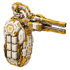

# WePlay: Personal Railgun Equipment (`WePlayRailgunEquipment`)

A 4x4 armor railgun that fires a piercing slug through every enemy in a straight line, picking the line that hits the most. Extremely powerful, extremely power-hungry.

- **Factorio:** 2.1
- **Dependencies:** base ≥ 2.1 (Space Age optional)
- **Current version:** 0.4.2
- **Mod portal:** https://mods.factorio.com/mod/WePlayRailgunEquipment

## In game

The railgun fires on its own. Every 10 ticks, each connected player's armor grid and the grid of the vehicle they're driving are checked for a railgun that is charged (5 MJ) and off cooldown (3 s). If one is ready and an enemy is in range (50 tiles), it fires:

1. **Targeting:** a heading toward each of the 80 nearest enemies is tried. For each heading, every enemy within reach is tested against a strip running from the wearer out to full range. An enemy counts as hit if its centre is within half the slug width plus its own collision radius of the line. The heading with the most hits wins; ties go to the nearer enemy.
2. **Damage:** every enemy in the winning strip takes base damage × multiplier (200 × 5 = 1000 by default) physical damage, with no falloff. Damage is dealt by the wearer, so kills count for them.
3. **Visuals:** a straight streak at shoulder height (two layers: a soft blue glow and a white core) that fades in over the first 2.5 tiles and out over the last 10, then dims away over 45 ticks; a short muzzle light; and a pale fog trail of puffs every 0.8 tiles that spreads and drifts on the wind for about 5 s. Wider slugs get a wider glow and up to 8 rows of fog spread across the strip.
4. **Sound:** a single heavy crack.

The drawn streak sits 0.7 tiles above the hit line (at the gun's height), the same way unit sprites sit above their feet. At the default 2.5-tile width the difference isn't noticeable.

**One per grid:** a second railgun placed in the same grid is handed back (to the cursor if possible, otherwise the inventory, otherwise spilled) with the message *"Structural integrity reached. Configure in map settings."* If more than one ends up in a grid anyway, only the best-quality one fires. With **Allow more than one railgun per grid** on, every railgun fires, at most one per wearer per check, so they take turns.

**Power:** each railgun holds 6 MJ and charges at up to 5 MW. A shot costs 5 MJ, and every railgun drains 150 kW all the time, shooting or not.

## Map settings

| Setting | Default | Range | What it does |
|---|---|---|---|
| Allow more than one railgun per grid | Off | On / Off | Off: a second railgun in a grid is handed back. On: every railgun in a grid fires, taking turns. |
| Damage multiplier | 5 | 1 – 10 | Multiplies the base damage. |
| Slug width (tiles) | 2.5 | 0.5 – 50 | Width of the strip each slug hits. Targeting uses this width. |

## Startup settings

| Setting | Default | Range | What it does |
|---|---|---|---|
| Base damage per shot | 200 | 1 – 100000 | Physical damage before the multiplier. |
| Range (tiles) | 50 | 5 – 150 | Targeting range and slug length. |
| Seconds between shots | 3 | 0.5 – 30 | Cooldown per railgun. |
| Energy per shot (MJ) | 5 | 0.1 – 1000 | Also sets the buffer (1.2 × shot) and charge rate (one shot per second). |
| Idle drain (kW) | 150 | 0 – 100000 | Constant draw per railgun while it's in a grid. |

## Getting it

Research **Personal railgun** after Personal laser defense and Military 4 (500 × automation, logistic, military, chemical, production and utility science, 60 s each).

| Recipe | |
|---|---|
| Ingredients | 2 × Personal laser defense, 50 × Processing unit, 25 × Low density structure, 1 × Personal battery MK2 |
| Crafting time | 60 s |
| Equipment size | 4 × 4 |
| Power | 6 MJ buffer, charges at up to 5 MW; 5 MJ per shot; 150 kW constant drain |

## How it works

- **Equipment:** a `battery-equipment` that only charges (`output_flow_limit = 0W`). The script does all the targeting and firing and spends the energy itself.
- **Idle drain:** grids holding a railgun are tracked in `storage.grids` (from `on_equipment_inserted`, `on_player_placed_equipment` and armor changes). Every 30 ticks each railgun's buffer is lowered by the drain; the grid refills it from batteries and generators.
- **Cooldowns:** stored per railgun in `storage.cool`, keyed by grid and grid position.
- **Enemies:** `find_entities_filtered` by enemy forces within range (plus the corners a wide slug can reach), kept if they're units, spawners, turrets, spider units, segmented units, characters or vehicles with health.
- **Streak:** `rendering.draw_line` pieces (8 for each fade, one for the middle), dimmed every 2 ticks by script and destroyed after 45 ticks.
- **Fog:** `wp-railgun-fog`, a copy of a vanilla trivial smoke made pale, slow, wind-blown and long-lived.

Performance: about 0.02 ms per tick at peak in testing.

### Not in this pass

- Parked vehicles and spidertrons driven by remote don't fire.
- Only player-placed duplicates are handed back (grids filled by robots or scripts rely on the best-quality rule).
- No research or quality bonuses to damage.

## Made with AI

AI was used heavily in the production of this mod. The code, documentation and portal description were written with Claude (Anthropic's AI assistant). The equipment icon, technology icon and thumbnail were generated with Grok. The streak and fog are drawn by script, and the sound was cut from a licensed stock clip. The design is directed, and every version played, tested and tuned in game, by the author.

## Credits

- The equipment icon, technology icon and thumbnail were made with AI image generation (Grok).
- The streak and fog trail were made procedurally for this mod.
- The shot sound was cut from an Envato Elements asset ("Steampunk Weapons - Tube Gun - shot03"). The sound file is used under the Envato Elements licence and is not covered by the Unlicense.

## Licence

Code released under the Unlicense (the sound file stays under its Envato Elements licence).
